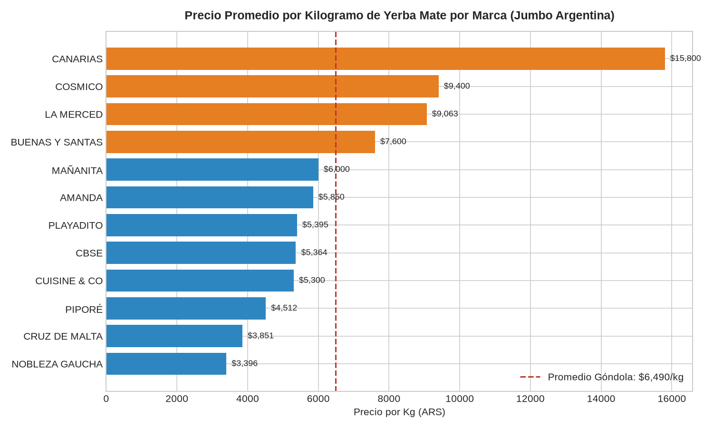

## 📋 Overview

**Yerba Mate Price Tracker** is an end-to-end Data Science and Business Intelligence project designed to collect, process, and analyze the historical and real-time price evolution of Yerba Mate in Argentina. 

The project evaluates the market impact of the **DNU 70/2023** deregulation (which eliminated price controls previously set by the *National Institute of Yerba Mate - INYM*), measures the price gap between primary producers and retail shelves, and compares nominal price increases against general inflation using the **Consumer Price Index (IPC - INDEC)**.

---

## 🎯 Key Objectives

1. **Historical & Structural Analysis:** Model weekly and monthly price fluctuations from 2015 to 2025 using official and econometric datasets.
2. **Deregulation Impact Assessment:** Compare real prices (in constant currency) before and after December 2023.
3. **Real-Time Retail Monitoring:** Automate current shelf-price extraction via web scraping (targeting major retail chains such as **Jumbo Argentina**) standardized per kilogram (`ARS/kg`).
4. **Interactive Visualization:** Build an executive Power BI dashboard and exploratory Python notebooks to detect price anomalies and brand dispersion.

---

## 📊 Data Sources & References

This project integrates historical datasets, official government reports, and live web scraping:

* **Ministry of Deregulation and State Transformation (Sept 2024):** Constant-peso price evolution in CABA, traded volumes, and post-DNU 70/2023 market deregulation metrics.
* **RIVAR Econometric Study (2023):** High-frequency weekly price dataset covering +300 Yerba Mate presentations (2015–2021), accounting for product attributes, seasonality, and exchange rate variations.
* **CEPA Report on the Yerba Mate Complex (Jan 2025):** Production figures, domestic consumption, exports, and farm-to-retail price spreads.
* **INDEC (IPC):** Official Consumer Price Index used to deflate nominal prices into real terms.
* **Live Retail Scraping (Jumbo Argentina):** Automated extraction of current product names, brands, weights (500g / 1kg), and retail prices.

---

## 🗂️ Repository Structure

Following standard Data Science repository conventions, the project is organized modularly:

```text
yerba-mate-price-analysis/
├── data/
│   ├── raw/                  # Unmodified datasets (CSV/Excel from official reports & raw scrapes)
│   └── processed/            # Cleaned, normalized (ARS/kg), and IPC-deflated datasets
├── notebooks/
│   ├── 01_eda_historical.ipynb       # Exploratory Data Analysis (2015-2025)
│   └── 02_inflation_comparison.ipynb # Nominal vs. Real price modeling
├── src/
│   ├── scraper_jumbo.py      # Web scraper for real-time retail prices (Jumbo)
│   └── etl_pipeline.py       # Data cleaning, unit normalization, and IPC adjustment scripts
├── dashboard/
│   └── yerba_mate_bi.pbix    # Power BI interactive executive report
├── requirements.txt          # Python dependencies
└── README.md                 # Project documentation
```

---

## ⚙️ Prerequisites & Installation

To run this project locally, ensure you have **Python 3.10+** installed.

1. **Clone the repository:**
   ```bash
   git clone https://github.com
   cd yerba-mate-price-analysis
   ```

2. **Create and activate a virtual environment (recommended):**
   ```bash
   python -m venv venv
   # On Windows:
   venv\Scripts\activate
   # On macOS/Linux:
   source venv/bin/activate
   ```

3. **Install required dependencies:**
   ```bash
   pip install -r requirements.txt
   ```
   *(Core libraries include `pandas`, `numpy`, `matplotlib`, `seaborn`, `requests`, and `beautifulsoup4`.)*

---

## 🚀 Usage

1. **Run the Web Scraper (Live Data Collection):**
   ```bash
   python src/scraper_jumbo.py
   ```
   *Outputs a timestamped CSV file inside `data/raw/` containing current shelf prices.*

2. **Execute the ETL & Normalization Pipeline:**
   ```bash
   python src/etl_pipeline.py
   ```
   *Standardizes all package weights to `Price per Kg` and merges historical series with IPC inflation data into `data/processed/`.*

3. **Explore Notebooks & Dashboard:**
   * Open `notebooks/01_eda_historical.ipynb` in Jupyter or VS Code to inspect statistical charts.
   * Open `dashboard/yerba_mate_bi.pbix` in Power BI Desktop to interact with the visual report.

---

## 📚 Academic Assignment Notes (Theoretical Framework)

*As part of the Technical English, Data Science & AI coursework, this section summarizes the foundational concepts applied to this repository:*

### 1. API vs. README File
* **README File (`README.md`):** A static documentation file written in Markdown aimed at **human users**. It explains what a project does, how to install it, and how to use it.
* **API (Application Programming Interface):** A programmatic interface and set of protocols (e.g., REST, JSON) aimed at **software applications**, allowing automated data exchange and system-to-system communication without human intervention.

### 2. CockroachDB & Classic README Structure
An analysis of the open-source **CockroachDB** repository confirms the use of the **classic GitHub README structure**, which served as the blueprint for this document:
* **Project Title & Concise Overview**
* **Build/License Status Badges**
* **Prerequisites & Quickstart / Installation Commands**
* **Usage, Testing & Architecture Guidelines**
* **Contributing & Licensing Terms**

---

## 🛠️ Technical Challenges & Troubleshooting

During the development of the data collection and ETL pipeline, several real-world technical obstacles were identified and resolved:

1. **Dynamic Client-Side Rendering (CSR) & Endpoint Redirection:**
   * *Issue:* Initial HTTP `GET` requests to Jumbo's internal VTEX routing endpoint (`_v/segment/routing/vtex.store@2.x/...`) triggered `JSONDecodeError` or redirected to the main homepage because prices are loaded dynamically via JavaScript and require active session cookies.
   * *Solution:* Migrated the extraction module (`scraper_jumbo.py`) from static `requests` to **Playwright** (headless Chromium), simulating full browser navigation with explicit category query parameters (`initialMap`, `map`, `query`) and progressive scrolling to render all product cards.

2. **Unstructured Product Card Layout & UI Noise:**
   * *Issue:* Product cards mixed brand names, full descriptions, promotional badges, and UI buttons (`"Ver Producto"`, `"Compra rápida"`), occasionally inverting brand and product fields or capturing non-target carousel items.
   * *Solution:* Implemented a text-filtering pipeline that strips UI labels, selects the longest string as the product title, enforces a strict keyword filter (`"yerba"`), and uses regular expressions (`re`) to extract package weights (`500g`, `550g`, `1kg`) for accurate `ARS/kg` normalization.

3. **Multi-Source Integration & Inflation Deflation:**
   * *Issue:* Official reports from CEPA, Ministry of Deregulation/INYM, and INDEC (IPC) are published across different formats and nominal scales.
   * *Solution:* Created `integrar_fuentes.py` to standardize periods (`YYYY-MM`), merge retail shelf prices with farm-gate leaf prices (`hoja verde`), calculate producer share percentages, and deflate nominal values into constant currency (Base Dec-2023 = 100).

---

## 📈 Key Findings & Visualizations

* **Current Retail Dispersion (Jumbo):** Average price of **$6,523.26 ARS/kg** (Median: **$5,472.82 ARS/kg** across 18 presentations), ranging from **$3,396.25/kg** (*Nobleza Gaucha*) to **$15,800.00/kg** (*Canarias*).
* **Deregulation & Producer Share Impact:** Following **DNU 70/2023**, real shelf prices peaked in early 2024 before stabilizing, while the primary producer's share of the final retail price contracted from **34.9%** (Oct 2023) to **13.3%–16.1%** (2025–2026).




---

## 🤝 Contributing & License

Contributions, issues, and feature requests are welcome. Feel free to check the issues page or submit a pull request.  
This project is licensed under the **MIT License**.
