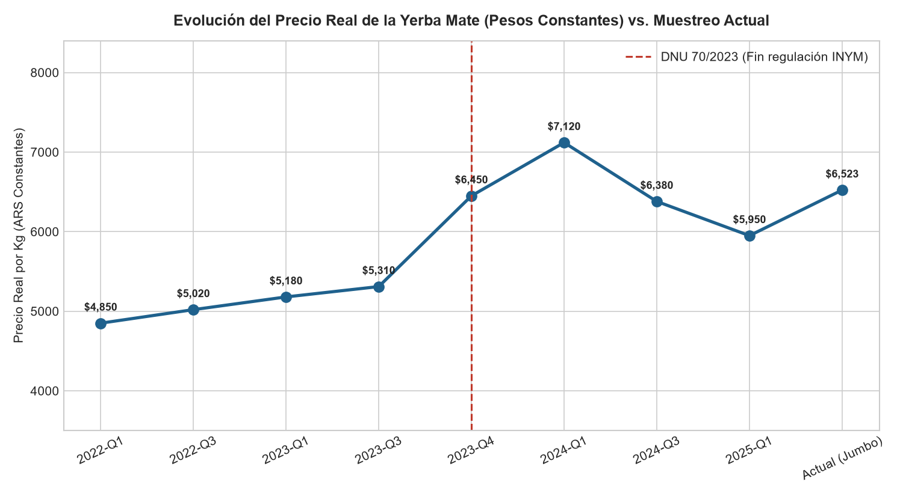
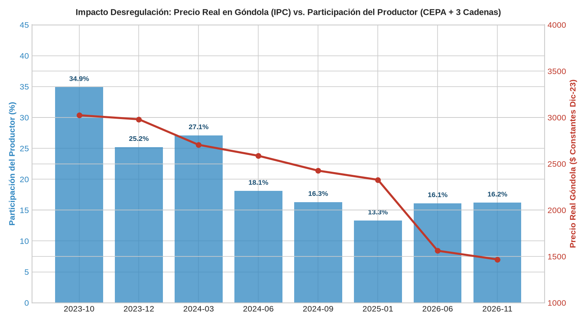
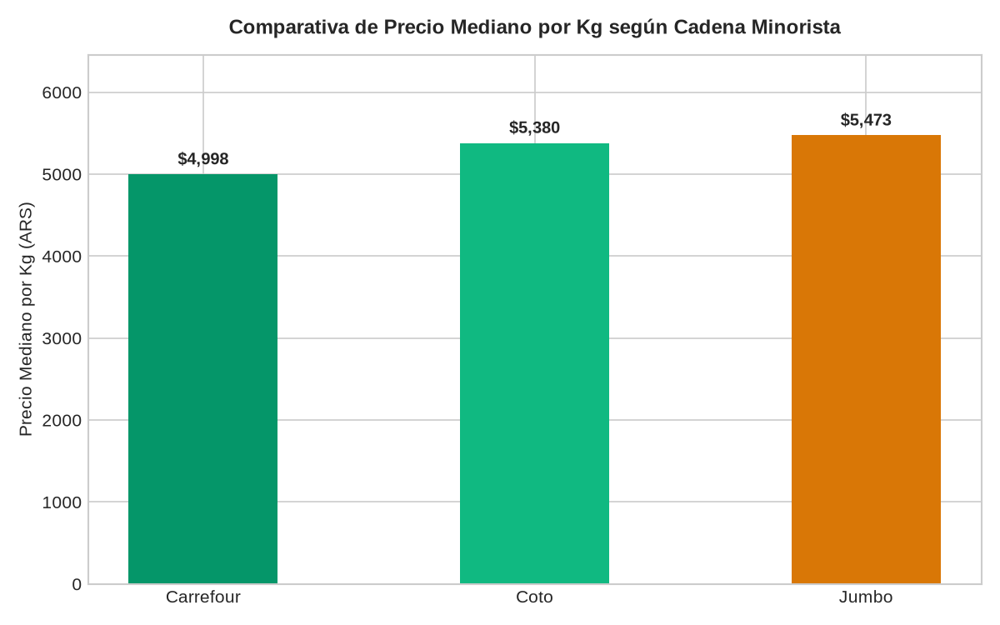

## 📋 Overview

**Yerba Mate Price Tracker** is an automated, end-to-end Data Engineering and Econometric Analytics pipeline designed to collect, process, and monitor the historical and real-time multi-retailer price evolution of Yerba Mate in Argentina (**Jumbo**, **Carrefour**, and **Coto**).

> 🚀 **Live Executive Dashboard:** Explore real-time cross-chain prices (236+ SKUs), brand dispersion, and inflation-adjusted historical trends at **[Yerba Mate Price Monitor (Streamlit App)](https://streamlit.app)**.

The project evaluates the structural market impact of the **DNU 70/2023** deregulation (which eliminated minimum price controls previously set by the *National Institute of Yerba Mate - INYM*), measures the value-chain spread between primary producers (`hoja verde`) and retail shelves, and deflates nominal prices into constant currency using the official **Consumer Price Index (IPC - INDEC)**.

---

## 🎯 Key Objectives

1. **Historical & Structural Analysis:** Model weekly and monthly price fluctuations from 2015 to 2026 using official macroeconomic and sector datasets (**INDEC**, **CEPA**, **INYM / Ministry of Deregulation**).
2. **Deregulation Impact Assessment:** Compare inflation-adjusted retail prices (in constant currency) and primary producer shares before and after **DNU 70/2023** (December 2023).
3. **Automated Multi-Retailer Monitoring:** Automate daily shelf-price extraction via headless web scraping (**Playwright**) across three major supermarket chains (**Jumbo**, **Carrefour**, and **Coto**), standardized per kilogram (`ARS/kg`).
4. **Executive Visualization & CI/CD Alerting:** Deploy an interactive **Streamlit & Plotly** executive web dashboard alongside automated **GitHub Actions** workflows and **Telegram** reporting to track brand dispersion and cross-chain pricing anomalies.

---

## 📊 Data Sources & References

This project integrates historical datasets, official government and sector reports, and live multi-retailer web scraping:

* **Ministry of Deregulation and State Transformation (Sept 2024):** Constant-peso price evolution in CABA, traded volumes, and post-**DNU 70/2023** market deregulation metrics.
* **RIVAR Econometric Study (2023):** High-frequency weekly price dataset covering +300 Yerba Mate presentations (2015–2021), accounting for product attributes, seasonality, and exchange rate variations.
* **Centro CEPA Reports on the Yerba Mate Complex (Jan 2025 & June 2026):** Production figures, domestic consumption, exports, green leaf (`hoja verde`) prices, and farm-to-retail value chain spreads.
* **INDEC (IPC):** Official National Consumer Price Index used to deflate nominal prices into constant currency (`Base Dec-2023 = 100`).
* **Live Multi-Retailer Scraping (Jumbo, Carrefour & Coto Argentina):** Automated headless extraction (**Playwright**) of 236+ active SKUs, capturing product descriptions, brands, package weights (`250g`, `500g`, `550g`, `1kg`), and standardized shelf prices (`ARS/kg`).

---

## 🗂️ Repository Structure

Following standard Data Science repository conventions, the project is organized modularly:

    yerba-mate-price-analysis/
    ├── .github/
    │   └── workflows/
    │       └── update_data.yml           # Automated CI/CD pipeline (runs Mon & Thu)
    ├── .streamlit/
    │   └── config.toml               # Executive dark theme configuration
    ├── dashboard/
    │   └── app.py                        # Interactive Streamlit & Plotly web dashboard
    ├── data/
    │   ├── raw/                          # Raw scrapes (Jumbo, Carrefour, Coto) & official CSVs (INDEC, CEPA)
    │   └── processed/                    # Cleaned, normalized (ARS/kg) & IPC-deflated datasets
    ├── notebooks/
    │   └── 01_eda_historical.ipynb       # Exploratory Data Analysis notebooks
    ├── reports/
    │   └── figures/                      # Automated statistical charts (4 PNGs)
    ├── src/
    │   ├── scraper_jumbo.py              # Headless browser scraper for Jumbo (Playwright)
    │   ├── scraper_carrefour.py          # Headless browser scraper for Carrefour (Playwright)
    │   ├── scraper_coto.py               # Headless browser scraper for Coto (Playwright)
    │   ├── etl_pipeline.py               # Multi-retailer normalization & statistical charts
    │   ├── integrar_fuentes.py           # Multi-source join (3 Chains + INDEC IPC + CEPA)
    │   └── enviar_reporte.py             # Automated Telegram & Email alert dispatcher
    ├── requirements.txt                  # Python dependencies
    └── README.md                         # Project documentation

---

## ⚙️ Prerequisites & Installation

To run this project locally, ensure you have **Python 3.10+** installed.

1. **Clone the repository:**
   ```bash
   git clone https://github.com
   cd yerba-mate-price-analysis
   ```

2. **Create and activate a virtual environment (recommended):**
   ```bash
   python -m venv venv
   # On Windows:
   venv\Scripts\activate
   # On macOS/Linux:
   source venv/bin/activate
   ```

3. **Install required dependencies:**
   ```bash
   pip install -r requirements.txt
   ```
   *(Core libraries include `pandas`, `numpy`, `matplotlib`, `seaborn`, `requests`, and `beautifulsoup4`.)*

---

## 🚀 Usage

1. **Run the Multi-Retailer Web Scrapers (Live Data Collection):**

       python src/scraper_jumbo.py
       python src/scraper_carrefour.py
       python src/scraper_coto.py

   *Outputs timestamped CSV files inside `data/raw/` containing current shelf prices across all three retail chains (~236 SKUs).*

2. **Execute the Multi-Retailer ETL & Normalization Pipeline:**

       python src/etl_pipeline.py

   *Unifies all three retail datasets, standardizes package weights to Price per Kg (`ARS/kg`), and generates statistical charts (`01`, `02`, and `04`) into `data/processed/` and `reports/figures/`.*

3. **Integrate Official Sources (INDEC IPC & CEPA):**

       python src/integrar_fuentes.py

   *Merges the multi-retailer median with official Consumer Price Index (`IPC`) and farm-gate leaf prices (`hoja verde`) into `data/processed/dataset_maestro_yerba.csv` and generates Chart `03`.*

4. **Launch the Executive Web Dashboard:**

       python -m streamlit run dashboard/app.py

   *Opens the local Streamlit web application with dark boardroom styling, multi-chain filters, KPIs, and interactive Plotly charts.*

5. **Automated Cloud Execution & Alerts (CI/CD):**
   * Configured via **GitHub Actions** (`.github/workflows/update_data.yml`) to execute the full multi-retailer pipeline automatically twice a week, commit updated datasets and charts, and dispatch executive summaries with attached visualizations via **Telegram Bot API** and **SMTP Email** (`src/enviar_reporte.py`) using encrypted GitHub Secrets.

---

## 📚 Academic Assignment Notes (Theoretical Framework)

*As part of the Technical English, Data Science & AI coursework, this section summarizes the foundational concepts applied to this repository:*

### 1. API vs. README File
* **README File (`README.md`):** A static documentation file written in Markdown aimed at **human users**. It explains what a project does, how to install it, and how to use it.
* **API (Application Programming Interface):** A programmatic interface and set of protocols (e.g., REST, JSON) aimed at **software applications**, allowing automated data exchange and system-to-system communication without human intervention.

### 2. CockroachDB & Classic README Structure
An analysis of the open-source **CockroachDB** repository confirms the use of the **classic GitHub README structure**, which served as the blueprint for this document:
* **Project Title & Concise Overview**
* **Build/License Status Badges**
* **Prerequisites & Quickstart / Installation Commands**
* **Usage, Testing & Architecture Guidelines**
* **Contributing & Licensing Terms**

---

## 🛠️ Technical Challenges & Troubleshooting

During the development of the multi-retailer data collection and ETL pipeline, several real-world technical obstacles were identified and resolved:

1. **Dynamic Client-Side Rendering (CSR) & Anti-Bot Protections:**
   * *Issue:* Initial HTTP `GET` requests to VTEX routing endpoints triggered `JSONDecodeError` or redirected to homepages, while headless scraping on Carrefour encountered hidden search containers (`top-search`) and non-breaking space characters (`\xa0`) breaking price parsing.
   * *Solution:* Migrated the extraction modules (`scraper_jumbo.py`, `scraper_carrefour.py`, `scraper_coto.py`) to **Playwright** with realistic browser headers, targeted visible product summary containers (`vtex-product-summary-2-x-container`), sanitized Unicode spaces (`\xa0`), and implemented URL pagination (`&page=1..8`) to capture **236+ unique SKUs**.

2. **Unstructured Product Card Layout & UI Noise Filtering:**
   * *Issue:* Search results across retailers mixed target packages with non-target accessories (thermoses, empty tins, tea bags) and UI labels (`"Ver Producto"`, `"Ver planes de cuotas"`), occasionally inverting brand and product fields.
   * *Solution:* Built a strict text-filtering pipeline that excludes accessory keywords and financing labels, prioritizes strings explicitly containing `"yerba"`, validates realistic `ARS/kg` bounds, and uses regular expressions (`re`) to extract package weights (`250g`, `500g`, `550g`, `1kg`).

3. **Multi-Source Integration & Inflation Deflation:**
   * *Issue:* Official reports from CEPA, Ministry of Deregulation/INYM, and INDEC (IPC) are published across different formats and nominal scales, requiring synchronization with live multi-retailer medians.
   * *Solution:* Created `etl_pipeline.py` and `integrar_fuentes.py` to unify daily scrapes across all three chains, standardize periods (`YYYY-MM`), merge retail medians with farm-gate leaf prices (`hoja verde`), calculate producer share percentages, and deflate nominal values into constant currency (Base Dec-2023 = 100).

---

## 📈 Key Findings & Visualizations

* **Multi-Retailer Dispersion (236 Live SKUs):** El mercado promedia **$5,755.68 ARS/kg** (Mediana: **$5,289.62 ARS/kg**) entre **Carrefour**, **Coto** y **Jumbo**, con un rango de **$3,438.00/kg** a **$21,260.00/kg**.
* **Cross-Chain Price Positioning:** **Carrefour** lidera en competitividad (**$5,199.00/kg** en 95 SKUs), seguido por **Coto** (**$5,380.00/kg** en 123 SKUs) y **Jumbo** (**$5,472.82/kg** en 18 SKUs, con mayor presencia de marcas premium).
* **Deregulation & Producer Share Impact:** Tras el **DNU 70/2023**, los precios reales sestabilizaron tras un pico en 2024, mientras que la participación del productor primario cayó del **34.9%** (Oct 2023) al **13.3%–16.4%** (2025–2026).






---

## 🔬 Methodological Scope, Data Provenance & Limitations

To ensure analytical rigor and transparency, the multi-retailer ETL (`etl_pipeline.py`) and historical integration module (`integrar_fuentes.py`) adhere to strict methodological boundaries:

* **Data Provenance & Triangulation:** Official macroeconomic baselines are sourced from **INDEC** (National Consumer Price Index - IPC, Base Dec 2016) to deflate nominal values, while primary production costs (`hoja verde`) and value-chain spreads are triangulated from **Centro CEPA** sector reports (Jan 2025 & June 2026) and **INYM / Ministry of Deregulation** statistical releases. Live shelf prices are extracted across three major retail chains (**Jumbo**, **Carrefour**, and **Coto**, totaling ~236 active SKUs).
* **Temporal Window Selection (2023–2026):** The integrated series intentionally focuses on the **October 2023 – November 2026** window to isolate the structural regime change triggered by **DNU 70/2023** (December 2023), capturing both the pre-deregulation baseline (regulated under Resolution 406/2023) and the subsequent free-market stabilization phase.
* **Methodological Approach & Robustness:** Farm-to-retail participation percentages are calculated using standard industrial conversion ratios (~3.0 kg of green leaf per 1.0 kg of processed retail yerba mate), comparing deflated series in constant December 2023 currency (`ARS Dic-23 = 100`). To prevent upward distortion from ultra-premium or imported brands (e.g., Uruguayan-style cuts exceeding $15,000/kg), the multi-retailer **median** (`ARS/kg`) is used as the primary benchmark indicator.
* **Scope Limitations:** Live price scrapes reflect e-commerce list prices for the **AMBA / Buenos Aires** distribution region and exclude temporary bank-specific cashbacks or loyalty-card discounts that require authenticated user sessions.

---

## 📉 Statistical Projections & Analytical Disclaimer

While this repository tracks historical trends and real-time multi-retailer dispersion, **it does not perform deterministic forecasting or speculative "futurology."**

* **IPC Nowcasting & Scenario Estimation:** Because official INDEC Consumer Price Index (`IPC`) releases carry a publishing lag relative to live daily web scrapes, the current period (`2026-11`) applies a technical extrapolation based on recent monthly inflation inertia (~1.9% monthly baseline) to deflate the live multi-retailer median (**$5,289.62 ARS/kg** across 236 SKUs).
* **Cross-Chain Variance Mitigation:** Aggregating data across three major retailers (**Carrefour**, **Coto**, and **Jumbo**) significantly reduces single-chain pricing noise, providing a more reliable baseline before formal time-series modeling is introduced.
* **Analytical Disclaimer:** All projected figures and deflated series are **analytical estimates** intended strictly for academic, portfolio, and exploratory monitoring purposes. Real-world retail prices remain subject to exogenous macroeconomic shocks, seasonal harvest yields (Misiones/Corrientes), and dynamic promotional strategies across supermarket chains.

---

## 🧠 Process Evaluation & Metacognition (Iterative Evolution)

Building this system followed an **iterative engineering cycle** rather than a linear workflow:

1. **From Static Requests to Headless Automation:** Initial prototypes assumed static JSON endpoints would suffice. Testing against live retail infrastructure forced a pivot to **Playwright** and DOM-level text filtering, reinforcing the importance of empirical validation over assumptions.
2. **From Local Scripts to Cloud CI/CD:** Moving from manual local execution (`src/`) to relative path resolution (`BASE_DIR`) and scheduled **GitHub Actions** transformed a one-off analysis into a self-updating monitoring system with real-time **Telegram** alerting.
3. **Single-Retailer to Multi-Channel Architecture (Completed Iteration):** Recognizing the sample bias of tracking only 18 SKUs in a single premium chain (Jumbo), the pipeline was expanded to integrate **Carrefour** and **Coto**, scaling coverage to **236+ live SKUs** and adding an executive dark-mode **Streamlit** interface for cross-chain comparison.
4. **Future Roadmap & Continuous Improvement:**
   * *Historical Database Persistence:* Migrating cumulative daily CSV snapshots into a structured relational database (**PostgreSQL / SQLite**) to track granular SKU-level price elasticity over time.
   * *Time-Series Modeling:* Once the automated cron job accumulates 6+ months of high-frequency multi-retailer scrapes, implementing formal **SARIMA / Prophet** models with confidence intervals to forecast seasonal price dynamics.

---

## 🌐 Cross-Industry Applications & Architectural Reusability

The underlying architecture built for this repository (**Dynamic Scraping with Playwright + ETL with Pandas + Official Data Merging + Streamlit Dashboard + Automated Telegram Alerts via GitHub Actions**) acts as a **reusable Data Pipeline Template**. By adapting only the target URLs and parsing rules, this engine can monitor markets and detect anomalies across multiple high-impact sectors:

1. **Competitive Intelligence in Retail & FMCG (*Pricing Intelligence*):**
   * *Basic Food Basket & Groceries:* Track cooking oils, dairy, meats, or beverages across major supermarket chains (**Jumbo, Carrefour, Coto**) to benchmark weekly price leadership.
   * *Electronics & Appliances:* Monitor pricing and interest-free financing terms across major e-commerce retailers to trigger automated commercial alerts when competitors drop prices on key SKUs.

2. **Agribusiness & Rural Inputs (*AgTech*):**
   * *Agro-Industrial Value Chain Spreads:* Replicate the farm-to-retail spread analysis for fluid milk, wheat flour, beef, or produce by merging wholesale market benchmarks (e.g., *Mercado Central*, *Cañuelas*) against retail shelf prices.
   * *Agricultural Inputs:* Track fertilizers, seeds, and machinery parts online alongside official exchange rates and grain commodity quotes.

3. **Real Estate & Construction (*PropTech*):**
   * *Real Estate Opportunity Radar:* Scan property portals filtering by neighborhood and price per square meter (`USD/m²`), sending instant Telegram alerts when listings appear 15%+ below the local median.
   * *Construction Cost Index:* Monitor cement, steel rebar, and brick prices from online building suppliers against the Argentine Chamber of Construction (`CAC`) index.

4. **Healthcare & Pharmaceuticals (*HealthTech*):**
   * *Medication Price Dispersion:* Compare over-the-counter and chronic medication prices across pharmacy chains, normalizing costs per pill or milligram (`ARS/mg`).

5. **Personal Finance, Investments & Tourism:**
   * *Airfare & Hospitality Monitor:* Detect sudden price drops in flights or accommodations for target destinations and dispatch instant mobile alerts.
   * *Macro & Financial Spread Tracking:* Automate daily executive reports cross-referencing exchange rates, interest rates, and projected inflation.

6. **Economic Observatories, Municipalities & Consulting:**
   * *Local Consumer Price Index (Municipal CPI):* Enable local governments, labor unions, or economic consultancies to measure weekly local inflation without relying exclusively on manual street surveys.

<details>
<summary><strong>7. ⚡ Renewable Energy Sector (EnergyTech & CleanTech) — Click to expand</strong></summary>
<br>
Cross-referencing hardware prices with regulated utility tariffs and climate data allows automated profitability tracking for distributed generation projects (e.g., Law 27,424 in Argentina):
<ul>
  <li><strong>Solar Equipment Cost Monitor (<code>USD / Watt-peak</code>):</strong> Scrape prices and specs of monocrystalline panels, hybrid inverters, and lithium batteries; use Regex to extract nominal power (<code>450W</code>, <code>550W</code>, <code>5kW</code>) and normalize costs to <code>USD/Wp</code> or <code>USD/kWh</code> against daily exchange rates, alerting via Telegram when costs hit target thresholds.</li>
  <li><strong>Automated Solar ROI Calculator:</strong> Merge installation costs with regional utility tariff schedules (Edenor, Edesur, EPE, EPEC) or <strong>CAMMESA</strong> reports to visualize residential/industrial payback periods in Streamlit.</li>
  <li><strong>Wind/Solar Generation & Grid Monitoring:</strong> Query daily public renewable generation reports from <strong>SADI</strong> (CAMMESA) to dispatch Telegram summaries on clean-energy demand coverage and weather forecasts.</li>
</ul>
</details>

<details>
<summary><strong>8. 💻 Technology & Infrastructure Sector (IT / DevOps / FinOps) — Click to expand</strong></summary>
<br>
Automated data pipelines serve as the backbone for infrastructure observability, cloud cost governance, and tech labor market analytics:
<ul>
  <li><strong>Cloud Cost Auditing (Automated <em>FinOps</em>):</strong> Query daily server usage across <strong>AWS, Azure, or Google Cloud</strong> against monthly project budgets, triggering critical Telegram alerts if anomalous consumption spikes occur outside business hours.</li>
  <li><strong>Vulnerability & Critical Patch Radar (<em>SecOps</em>):</strong> Monitor security bulletins (<strong>CISA, NVD</strong>) and changelogs for core stack dependencies (Python, Docker, Linux, PostgreSQL), filtering for high/critical severity (<code>CVSS >= 8.0</code>) to alert IT teams immediately.</li>
  <li><strong>Tech Salary & Skill Demand Observatory:</strong> Scrape IT job boards (LinkedIn Jobs, Get on Board, Indeed) for roles like <em>Data Engineer</em>, <em>ML Engineer</em>, or <em>DevOps</em>, counting weekly keyword frequency (<code>Python</code>, <code>SQL</code>, <code>Docker</code>, <code>AWS</code>, <code>Playwright</code>) and salary bands.</li>
  <li><strong>Availability & Latency Monitor (<em>Synthetic Monitoring</em>):</strong> Use scheduled GitHub Actions workflows to verify internal APIs, SSL certificates, and corporate endpoints (<code>200 OK</code>) and measure response latency in milliseconds, sending instant downtime alerts to Telegram.</li>
</ul>
</details>

---

## ❓ Technical FAQ (Frequently Asked Questions)

<details>
<summary><strong>1. Why did you choose Playwright instead of lighter libraries like Requests or BeautifulSoup?</strong></summary>
<br>
Modern supermarket e-commerce platforms (such as VTEX IO architectures) rely on <strong>Client-Side Rendering (CSR)</strong>. Standard static HTTP GET requests return an empty HTML shell without product prices because data is injected dynamically via JavaScript. <strong>Playwright</strong> launches a headless Chromium browser, executes client-side scripts, simulates progressive scrolling, and waits for visible product containers before extracting data.
</details>

<details>
<summary><strong>2. Why is the Median used instead of the Arithmetic Mean as the primary benchmark?</strong></summary>
<br>
Retail shelf prices exhibit strong positive skewness caused by imported or ultra-premium cuts (e.g., Uruguayan-style brands exceeding $15,000 ARS/kg compared to a mass-market baseline around $5,200 ARS/kg). The arithmetic mean gets pulled upward by these outliers, whereas the <strong>median ($5,289.62 ARS/kg across 236 SKUs)</strong> provides a statistically robust measure of what a typical consumer actually pays.
</details>

<details>
<summary><strong>3. How are API tokens and credentials secured in a public GitHub repository?</strong></summary>
<br>
No credentials or tokens are ever hardcoded in the source code. Sensitive keys (<code>TELEGRAM_TOKEN</code> and <code>TELEGRAM_CHAT_ID</code>) are stored encrypted inside <strong>GitHub Repository Secrets</strong>. During scheduled GitHub Actions runs, these secrets are injected temporarily into memory as environment variables (<code>os.getenv()</code>) and wiped immediately after execution.
</details>

<details>
<summary><strong>4. What were the main Data Cleaning challenges when merging three different retail chains?</strong></summary>
<br>
Each supermarket chain structures its DOM and product labels differently, requiring three specific normalization rules:
<ul>
  <li><strong>UI & Accessory Noise Filtering:</strong> Excluding non-target items (thermoses, empty tins, tea bags) and financing buttons (<code>"Ver planes de cuotas"</code>).</li>
  <li><strong>Hidden Unicode Sanitization:</strong> Stripping non-breaking space characters (<code>\xa0</code>) inserted between currency symbols and numbers.</li>
  <li><strong>Unit Standardization:</strong> Using Regular Expressions (<code>re</code>) to parse varied package weights (<code>250g</code>, <code>500g</code>, <code>550g</code>, <code>1kg</code>) into a unified <code>ARS/kg</code> metric.</li>
</ul>
</details>

<details>
<summary><strong>5. Does the system currently perform Machine Learning forecasting?</strong></summary>
<br>
Currently, the pipeline performs <strong>descriptive analytics, multi-retailer benchmarking, and econometric nowcasting</strong> (deflating nominal prices via INDEC's IPC to measure primary producer share contraction from 34.9% to 16.4% post-DNU 70/2023). Formal time-series forecasting models (such as <strong>SARIMA or Prophet</strong>) are scheduled for the next phase once the automated cron job accumulates several months of high-frequency daily historical snapshots.
</details>

---

## 🤝 Contributing & License

Contributions, issues, and feature requests are welcome. Feel free to check the issues page or submit a pull request.  
This project is licensed under the **MIT License**.
